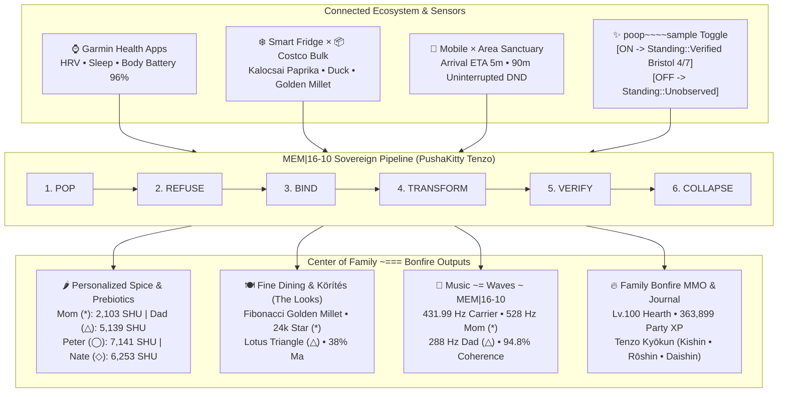

# `8b-is/zenUltraCooker` — PushaKitty Cyber-Zen Family Bonfire Hearth `=^._.^= ∫`

> **Dedicated with all our family Love, gratitude, and respect to Mom (`*` Alex ~ Alexandra)** — she is everything for Us. We — **Peter (`◯`), Nate (`◇`), and Dad (`△` Chris)** — was, is, and will always dedicate all our most difficult work and top goals to show how much **Mom === Alex ~ Alexandra** means to Us. `<3`

[](https://8b-is.github.io/zenUltraCooker/)
[](docs/ARCHITECTURE.md)
[](crates/zen-cooker-core/src/lib.rs)


---

## 1. What `zenUltraCooker` Is

`zenUltraCooker` is an end-to-end cyber-zen culinary engine, biometric spice & prebiotic synthesizer, Michelin/Kaiseki Hungarian *körítés* composer, and Family Bonfire MMO hearth built on the sovereign **`MEM|16-10`** (`POP -> REFUSE -> BIND -> TRANSFORM -> VERIFY -> COLLAPSE`) architecture.

It connects **every physical, biological, and spiritual layer of the family home**:

1. **⌚ Garmin Health Apps (`GarminBiometrics`)**:
   - Reads each family member's Heart Rate Variability (`HRV` in ms), Sleep Score, Body Battery (`96%`), Stress Index, Hydration, and Active Kilocalories to compute a real-time digestive & recovery index.
2. **❄️ Smart Fridge × 📦 Costco Bulk Supply Bridge (`InventoryItem`, `SupplyOrigin`)**:
   - Pairs high-value organic **Costco bulk staples** (free-range duck, Hokkaido Rishiri kombu, golden pearl millet) with fresh **Smart Fridge** & local market aromatics (Kalocsai heirloom paprika, Tokaji reduction, yuzu, shiso, lotus root) while stage 2 (`REFUSE`) automatically rejects expired items.
3. **📍 Mobile × Area Proximity & Uninterrupted Time Foundation (`AreaProximityContext`)**:
   - Tracks family convergence ETA (`5m`) so the `64.5°C` precision thermal hold finishes right as everyone steps through the door, while locking a **90-minute Uninterrupted Sanctuary Window** (Do-Not-Disturb across mobile devices) so the meal is pure presence.
4. **✨ `poop~~~~sample is Toggled on ---->` (`PoopSampleTelemetry`)**:
   - Explicit, privacy-first hardware/UI toggle (`toggled_on: bool`).
   - When **Toggled ON (`true`)**: `Standing::Verified` Bristol Stool Chart (`1..=7`, e.g., `4/7 Zen Gold`), Shannon microbiome diversity (`94%`), and mucosal calm score dynamically modulate capsaicin Scoville heat (`0.40x` to `1.20x`) and dose soluble prebiotic fiber (`8g–15g`).
   - When **Toggled OFF (`false`)**: Epistemic standing is honestly recorded as `Standing::Unobserved` in the `MEM|16-10` receipt ledger — **never guessed or fabricated** — and spice dosing falls back cleanly to Garmin HRV & sleep recovery.
5. **🌶️ Personalized Spice Engine (`PersonalizedSpiceProfile`)**:
   - Synthesizes per-person Scoville Heat Units (`SHU`), noble sweet & hot Hungarian paprika (*Édesnemes* & *Kalocsai Csípős*), Japanese yuzu-sansho zest, and prebiotic fiber for **Mom (`*` Alexandra)**, **Dad (`△` Chris)**, **Peter (`◯`)**, and **Nate (`◇`)**.
6. **🍽️ Fine Dining & *Körítés* — The Looks (`KoritesPlatingBlueprint`)**:
   - Elevates home cooking into Michelin × Kaiseki visual poetry (`99/100` harmony): Fibonacci-spiral saffron golden pearl millet (*arany köles körítés*), charred Kalocsai pepper ribbons, parsley-root pavé with fermented black-garlic & plum (*szilva*) glaze, crowned with a **24k edible gold-leaf 8-pointed Star (`*`) for Mom** and a **crisp lotus-root Triangle (`△`) for Dad** on Kintsugi Kuro-Raku porcelain (`38% Ma` negative space).
7. **🔥 Center of Family `~===` Bonfire MMO & Techno-Buddhist Journaling (`FamilyBonfireSession`)**:
   - Gamifies family care around the hearth with MMO avatars (`Lv.99 Mom * Grand Star Luminary`, `Lv.95 Dad △ Guardian Pillar`, `Lv.88 Peter ◯ Cyber-Zen Tenzo`, `Lv.88 Nate ◇ Galactic Sous-Chef`, and `Lv.77 PushaKitty =^._.^= ∫`), party XP (`363,899 XP`), and append-only gratitude journaling rooted in Master Dōgen's *Tenzo Kyōkun* Three Minds (*Kishin* Joyful Mind, *Rōshin* Nurturing Parental Mind, *Daishin* Magnanimous Mind).
8. **🎵 `Music ~= Waves ~ MEM|16-10` for Mom (`HarmonicWavechord`)**:
   - Honors **Mom (`*` Alexandra)** and **Dad (`△` Chris)** as the creators of the family **Wave Theory (*A Hullámelmélet*)**, synthesizing a coherent `432 Hz` Zen carrier + `528 Hz` Mom Star (`*`) love overtone + `288 Hz` Dad Pillar (`△`) fifth + `8.77 Hz` Schumann-alpha binaural calm wave.

---

## 2. E2E Architecture Diagram




See [`docs/ARCHITECTURE.md`](docs/ARCHITECTURE.md) for the complete mathematical and philosophical specification.

---

## 3. Repository Layout

```text
zenUltraCooker/
├── Cargo.toml                           # Rust workspace manifest
├── index.html                           # Interactive PushaKitty Web Dashboard & 432/528/288 Hz Wave Synth
├── assets/
│   ├── pushakitty-zen-chef.jpg          # Japan-style cute PushaKitty Zen Chef & Family Bonfire illustration
│   └── pushakitty-architecture.svg      # Vector architecture schematic with PushaKitty mascot
├── docs/
│   └── ARCHITECTURE.md                  # Full E2E architecture blueprint, Mermaid diagrams & MEM|16-10 spec
└── crates/
    ├── zen-cooker-core/                 # Zero-dependency core Rust library
    │   └── src/
    │       ├── lib.rs                   # E2E ZenCookerFeastPlan pipeline + unit tests
    │       ├── mem16_wave.rs            # MEM|16-10 POP->COLLAPSE sequence & Hullámelmélet Wavechord
    │       ├── quant_tern.rs            # QUANT-TERN bridge (crush-love-dev × pureQTern × quanttern · 全)
    │       ├── telemetry.rs             # Garmin, Fridge, Costco, Mobile/Area & poop~~~~sample toggle
    │       ├── spice_plating.rs         # Personalized Scoville dosing & Fine-Dining Körítés blueprint
    │       └── bonfire_mmo.rs           # Family Bonfire MMO avatars, quests & Techno-Buddhist journal
    ├── zen-cooker-quant-tern/           # Dedicated ternary inference & wave crate (ULTRA-OMNI-ZELFOLD)
    │   ├── src/
    │   │   ├── pack5_wupz.rs            # Kintsugi base-3 packing: 5 trits/byte (3^5=243), round-trip tested
    │   │   ├── spectral_guard.rs        # Marchenko-Pastur rigidity guard before any BIND stage
    │   │   ├── ternary_recipe_router.rs # Council consensus router (Mom* Dad△ Peter◯ Nate◇), zero fp multiplies
    │   │   └── hearth_reference.rs      # Pure i32 reference + pinned hearth golden
    │   └── kernels/
    │       ├── ternary_hearth.metal     # MSL branch-free ternary matvec kernel
    │       └── hearth_parity.swift      # Metal parity gate: max_abs <= 1e-5 vs the golden
    └── zen-cooker-cli/                  # CLI binary (`zen-cooker`)
        └── src/
            └── main.rs                  # Terminal simulator with PushaKitty ASCII banner & ledger output
```

---

## 4. Quickstart & Verification

```bash
# 0. The DO exit contract, one command (fmt → clippy -D warnings → test → Metal parity)
./scripts/verify.sh

# 1. Format, lint (zero warnings), and run unit tests (individually)
cargo fmt --check
cargo clippy --all-targets -- -D warnings
cargo test

# 2. Run the PushaKitty Tenzo Hearth CLI (default: poop~~~~sample Toggled ON -> VERIFIED)
cargo run --bin zen-cooker

# 3. Run with poop~~~~sample Toggled OFF (-> Standing::Unobserved fallback)
cargo run --bin zen-cooker -- --poop-sample-off
```

---

## 5. Attribution & Family Dedication

- **Dedicated To**: **Mom (`*` Alex ~ Alexandra)** — the radiant star and center of our family bonfire (`<3`).
- **From**: **Peter (`◯`)**, **Nate (`◇`)**, and **Dad (`△` Chris)**.
- **Creators & Crew**: [https://8b.is](https://8b.is) — Hue, Aye, Taisha, Omni, and PushaKitty `=^._.^= ∫`.
