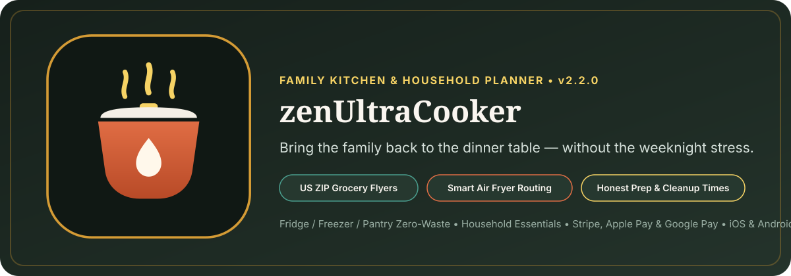

# zenUltraCooker (`v2.2.0`) — Family Kitchen, Grocery & Household Planner

[](https://8b-is.github.io/zenUltraCooker/)
[-2A7B6C?style=for-the-badge)](https://github.com/8b-is/zenUltraCooker/releases/tag/v2.2.0)
[-16201B?style=for-the-badge)](mobile/ios/)
[](docs/ELI5-STRIPE-APPLE-PAY-GOOGLE-PAY.md)



> **Dedicated to Alex (Mom)** from Peter, Nate, Chris, and our Son in College.  
> *When Mom cooks, the family comes together — and eating together at least once a day is one of the strongest protective factors for family health and connection.*

---

## 1. Product Overview

Rising grocery prices, busy work schedules, blended family calendars, out-of-order kitchen appliances, and last-minute food-delivery cancellations make putting a daily family meal on the table difficult. **`zenUltraCooker`** is an all-in-one household kitchen organizer, grocery planner, and recipe companion built for real weeknights:

1. **📍 US 5-Digit ZIP Code Grocery Flyers & Local Farmers Markets**
   - Compares weekly store circulars (ALDI, Kroger, H-E-B, Trader Joe's, Smith's) and weekend Farmers Market specials by 5-digit US ZIP code (`44256`, `84604`, `78701`, `90210`, `10001`).
   - Includes a **15-Minute DoorDash-Cancel Freezer Rescue** workflow that routes stocked freezer and pantry staples into a hot family dinner in 15 minutes (`$68.50+` saved vs. late delivery).
2. **❄️ Fridge, Freezer, Pantry & Household Essentials Tracker**
   - Tracks ingredients across **Fridge, Freezer, and Pantry** sorted by expiration date so food never goes to waste.
   - Tracks recurring household supplies right alongside groceries: **toilet paper, kitchen trash bags, laundry detergent, dog waste bags, and tomorrow's Advisor Lunch donuts**.
3. **⚡ Smart Kitchen Appliance Routing (`Air Fryer Primary`)**
   - Tracks which appliances are online and which are out of commission. When the **Wall Oven is marked Offline / Broken**, recipes automatically adapt to the **Dual-Zone Air Fryer** (`400°F · 14m crisp · 7m single-liner cleanup`).
4. **⏱️ Honest Prep, Cook & Cleanup Times**
   - Every recipe displays **true wall-clock time**: real unwashed produce prep + active cooking + dish and counter cleanup (`10m prep + 14m Air Fryer + 7m cleanup = 31m real total`).
   - Supports web recipe imports, **Private Family Recipes** vs. **Shared Community Recipes**, 5-star family ratings, and dinner table photo notes to keep favorite meals in weekly rotation.
5. **👨‍👩‍👦‍👦 Blended Family Profiles, Smart Reminders & College Speakerphone Seat**
   - Tracks dinner headcount, who cooks vs. who handles **dish cleanup and school lunch boxes**, dietary needs (including **postpartum/breastfeeding nutrition & hydration** and **nut-free school lunches**), and a live **Speakerphone Seat** for family members away at college.
6. **💳 1-Tap Checkout (Stripe, Apple Pay & Google Pay) + Plain-English Setup Guide**
   - Integrated express checkout (`Apple Pay`, `Google Pay`, `Stripe Link / acct_1UUTcTRnidUxAlVy`) backed by the **4-Burner Household Budget Firewall** and documented in a plain-English setup guide ([`docs/ELI5-STRIPE-APPLE-PAY-GOOGLE-PAY.md`](docs/ELI5-STRIPE-APPLE-PAY-GOOGLE-PAY.md)).

---

## 2. End-to-End App Icon & Brand Asset Packs (`v2.2.0`)

Generated deterministically via [`scripts/generate-app-icons.py`](scripts/generate-app-icons.py):

| Platform / Surface | Location | Included Assets |
| :--- | :--- | :--- |
| **Master Vector Artwork** | [`assets/icons/app-icon-master.svg`](assets/icons/app-icon-master.svg) · [`assets/brand-hero.svg`](assets/brand-hero.svg) | Scalable 1024×1024 warm terracotta Dutch-oven / Air-Fryer hearth icon & 1200×420 editorial hero banner. |
| **iOS / iPadOS / macOS (`AppIcon.appiconset`)** | [`mobile/ios/ZenUltraCookerApp/Assets.xcassets/AppIcon.appiconset/`](mobile/ios/ZenUltraCookerApp/Assets.xcassets/AppIcon.appiconset/) | Full Xcode Asset Catalog (`Contents.json` + all 15 opaque PNG sizes from `20×20` through `1024×1024` App Store marketing icon). |
| **Android Mipmap & Adaptive Icons** | [`mobile/android/app/src/main/res/`](mobile/android/app/src/main/res/) · [`assets/icons/playstore-icon-512.png`](assets/icons/playstore-icon-512.png) | `mipmap-{mdpi,hdpi,xhdpi,xxhdpi,xxxhdpi}/ic_launcher.png` & `ic_launcher_round.png`, adaptive vector `drawable/ic_pawshaw.xml`, and `512×512` Google Play icon. |
| **Web / PWA / Social Pack** | [`assets/icons/`](assets/icons/) · [`site.webmanifest`](site.webmanifest) · [`favicon.ico`](favicon.ico) | Multi-size `favicon.ico` (`16/32/48`), `favicon-16x16.png`, `favicon-32x32.png`, `apple-touch-icon.png` (`180×180`), `icon-192.png`, `icon-512.png`, `icon-maskable-512.png`, and `og-social-card.png` (`1200×630`). |

---

## 3. Native Mobile Apps & Release Artifacts (`v2.2.0` / Build `20200`)

| Target | Version / Build | Path / Download | Description |
| :--- | :--- | :--- | :--- |
| **📱 Android APK** | `2.2.0` (`versionCode: 20200`) | [`releases/zenUltraCooker-v2.2.0.apk`](releases/zenUltraCooker-v2.2.0.apk) | Signed (v2 + v3 scheme) Android package (`is.eightb.zenultracooker`) with full `mipmap-*` launcher icons, offline kitchen planner, and `AndroidHearthBridge` for Google Pay & Stripe. |
| **🍎 iOS / iPadOS SwiftUI App** | `2.2.0` (`CFBundleVersion: 20200`) | [`mobile/ios/`](mobile/ios/) | Native SwiftUI package (`is.8b.zenultracooker`) with `AppIcon.appiconset`, Apple Pay entitlement (`merchant.is.8b.zenultracooker`), and 7/7 automated self-tests. |
| **📖 Stripe / Apple Pay / Google Pay Guide** | `2.2.0` | [`docs/ELI5-STRIPE-APPLE-PAY-GOOGLE-PAY.md`](docs/ELI5-STRIPE-APPLE-PAY-GOOGLE-PAY.md) | Plain-English guide for switching Stripe from Test to Live mode, enabling Apple Pay & Google Pay, and protecting the household budget. |

---

## 4. Quickstart & Verification

```bash
# 1. Run full-stack verification (SemVer lockstep → Rust fmt/clippy/tests → Metal parity → iOS Swift self-test → Android APK signature check)
./scripts/verify.sh

# 2. Regenerate all iOS, Android, and Web/PWA App Icon Packs
uv run --with pillow python scripts/generate-app-icons.py

# 3. Rebuild & sign the Android APK (releases/zenUltraCooker-v2.2.0.apk)
./scripts/build-apk.sh

# 4. Run the Rust CLI planner
cargo run --bin zen-cooker
```

---

## 5. Repository Structure

```text
zenUltraCooker/
├── VERSION                              # Single-source SemVer 2.0.0 version pin (2.2.0)
├── CHANGELOG.md                         # Release history (1.0.0 -> 2.0.0 -> 2.1.0 -> 2.2.0)
├── Cargo.toml                           # Rust workspace manifest (v2.2.0)
├── index.html                           # Editorial Web App & Interactive Family Kitchen Planner
├── site.webmanifest                     # Web App Manifest (PWA icons & theme colors)
├── favicon.ico                          # Multi-resolution browser favicon (16/32/48)
├── assets/
│   ├── brand-hero.svg                   # Clean editorial hero illustration
│   └── icons/                           # Master SVG, PWA icons, Apple Touch icon, Play Store 512 & OG card
├── releases/
│   └── zenUltraCooker-v2.2.0.apk        # Signed & zipaligned Android APK (versionCode 20200)
├── mobile/
│   ├── android/                         # Android project + mipmap-{mdpi..xxxhdpi} launcher icons
│   └── ios/                             # Native iOS/macOS SwiftUI package + Assets.xcassets/AppIcon.appiconset
├── docs/
│   ├── ELI5-STRIPE-APPLE-PAY-GOOGLE-PAY.md # Plain-English Stripe, Apple Pay & Google Pay guide
│   └── ARCHITECTURE.md                  # System architecture overview
├── scripts/
│   ├── generate-app-icons.py            # E2E iOS, Android & Web/PWA icon pack generator
│   ├── build-apk.sh                     # Android SDK APK builder & signer
│   └── verify.sh                        # Full-stack verification script
└── crates/
    ├── zen-cooker-core/                 # Zero-dependency core Rust library
    ├── zen-cooker-quant-tern/           # Kitchen routing & Metal parity verification crate
    └── zen-cooker-cli/                  # Command-line interface (`zen-cooker`)
```
