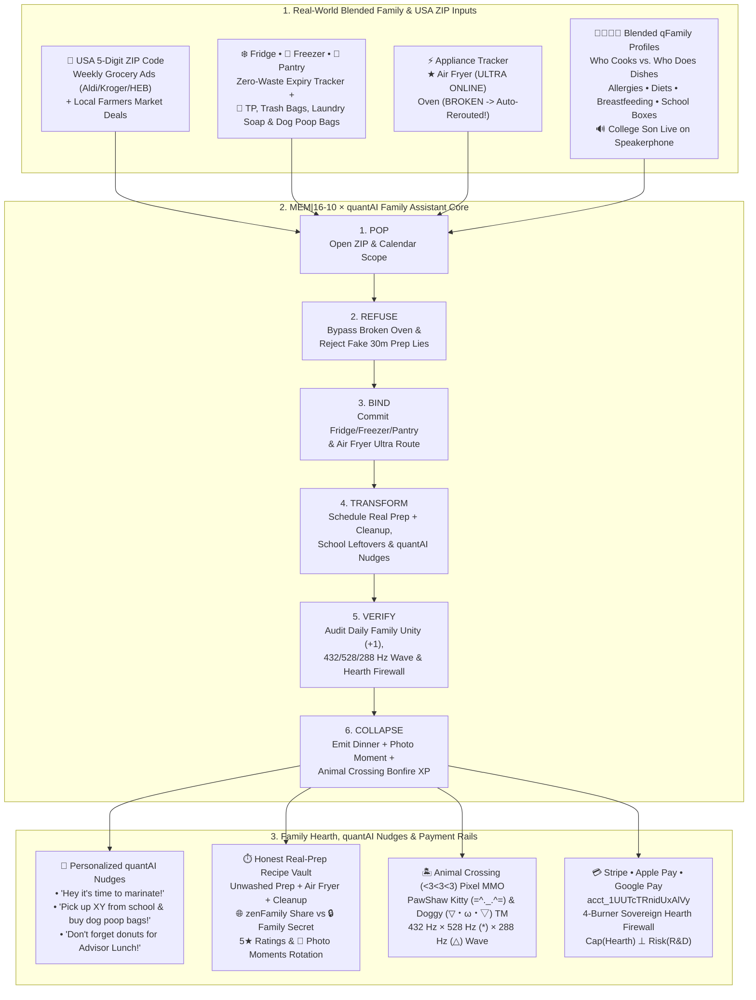

# `8b-is/zenUltraCooker` v2.0.0 — E2E System Architecture & Product Blueprint

> **Dedicated with all our family love, gratitude, and respect to Mom (`*` Alex ~ Alexandra / Dra)** — she is everything for Us. Peter (`◯`), Nate (`◇`), Dad (`△` Chris), and College Son (`🔊` on Speakerphone) was, is, and will always dedicate all our most difficult work and top goals to show how much **Mom === Alex ~ Alexandra / Dra** means to Us. `<3`

---

## 1. Executive Vision: Why `zenUltraCooker` Exists (`When Mom Cooks, the Family Comes Together`)

When a family eats together at least once a day, it **drastically reduces the risk of drug abuse and out-of-bounds addictions**. Yet rising USA grocery prices, hectic work schedules, blended family calendars, broken appliances, and late-notice or DoorDash cancellations make daily family dinner harder than ever.

`zenUltraCooker` v2.0.0 (**SIMPLIFY + PRODUCTIZE**) solves this by combining a **Global Family App** with a **Personalized Profile-Based `quantAI` Assistant** and an **Animal Crossing (`<3<3<3`) Pixel-Art Cozy Bonfire MMO** trademarked by **`PawShaw Kitty (=^._.^= ∫) & PawShaw Doggy (▽・ω・▽)`**:

- **No microbiome stool sensors or complex Scoville math required** — simplified around real USA families.
- **USA 5-Digit ZIP Code Local Grocery Ads & Farmers Market Engine**: Matches weekly circulars (Aldi, Kroger, Meijer, H-E-B, Trader Joe's, Costco) and local weekend Farmers Market stands to slash grocery bills and rescue canceled DoorDash orders in 15 minutes.
- **Fridge ❄️, Freezer 🧊 & Pantry 🥫 Zero-Waste Tracker + Household Essentials 🧻🐾**: Tracks food expiry alongside regular household additions (**Toilet Paper, Trash Bags, Laundry Soap, Poop Bags for the Dogs, and Advisor Lunch Donuts**).
- **Appliance Tracker (`Air Fryer = Ultra Appliance of All Time ★`)**: Tracks working vs. broken appliances (e.g., `Oven == BROKEN [−1]`) and automatically reroutes meals to the **Air Fryer Ultra (`+1`)**.
- **The Anti-Rachael Ray Honest Prep & Cleanup Law**: Every recipe reports real unwashed prep + marinate/thaw alert + active cook + **real dish & basket cleanup time**, rated `1..=5 ★` with **Family Photo Moments (`📸`)** to keep favorite meals in rotation, and toggleable between **Shared with `zenFamily` (`🌐`)** and **Family Secret (`🔒`)**.
- **Everyone Is Welcome Around the Stove or Table**: Including **our Son in College calling in live on Speakerphone (`🔊`)** while dinner cooks!

---

## 2. End-to-End Product Architecture (Mermaid)

---

## 3. Inverting Beckett's *Endgame*: `Gondolkodom, Theat vagyOK -> cogito ergo summa summarum or just BE <3`

| Samuel Beckett's *Endgame* (`−1` Skull Prison) | `8b-is/zenUltraCooker` v2.0.0 (`+1` Sovereign Family Hearth for **Dra**, **Nate**, **Chris** & **Peter**) |
|---|---|
| **Clov's $10\times 10\times 10$ Waiting Kitchen**: *"There's no more pap."* | **Dra's Air Fryer Ultra & 4-Burner Sovereign Hearth**: Fridge, Freezer, and Pantry tracked with zero waste; broken oven bypassed by the Air Fryer Ultra in 14 crispy minutes. |
| **Zeno's Impossible Millet Heap**: *"Grain upon grain..."* | **Golden Pearl Millet *Körítés* & +2 School Lunch Leftover Boxes**: Every grain nourishes the family and packs tomorrow's school lunches. |
| **Isolated Ashbins**: Nagg and Nell unable to reach each other. | **Blended `qFamily` Table + College Son on Speakerphone (`🔊`)**: Distance dissolves when the college son calls on speakerphone while Mom and the crew cook dinner around the stove. |
| **The Tailor's Trousers (`Page 12`)**: *"Look at the world — and look at my TROUSERS!"* | **The Anti-Rachael Ray Honest Timer & `quantAI` Companion**: Zero fake "30-minute" prep lies; tailored to the real minute including dish cleanup, dog poop bags, school pickup, and Advisor Lunch donuts. |
