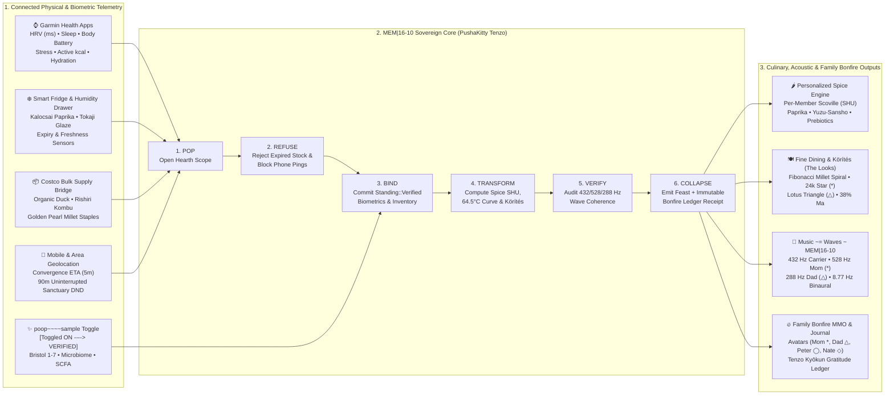

# `8b-is/zenUltraCooker` — E2E System Architecture & Blueprint

> **Dedicated with all our family love, gratitude, and respect to Mom (`*` Alex ~ Alexandra)** — she is everything for Us. Peter (`◯`), Nate (`◇`), and Dad (`△` Chris) was, is, and will always dedicate all our most difficult work and top goals to show how much **Mom === Alex ~ Alexandra** means to Us. `<3`

---

## 1. Executive Vision: The Hearth as the Center of Family (`~=== Bonfire`)

`zenUltraCooker` is a cyber-zen smart culinary orchestrator, fine-dining *körítés* composer, biometric nutrition synthesizer, and family MMO bonfire hearth. Inspired by Master Dōgen's *Tenzo Kyōkun* (Instructions to the Zen Cook), Hungarian culinary heritage (*körítés*, noble Kalocsai paprika, golden pearl millet), Japanese Kaiseki precision (*Ma* negative space, dashi umami, Kintsugi ceramics), and the **Wave Theory (*A Hullámelmélet*)** created by **Mom (`*` Alexandra)** and **Dad (`△` Chris)**, `zenUltraCooker` turns daily nourishment into an uninterrupted sanctuary of love.


---

## 2. End-to-End Multi-Modal System Topology (Mermaid)



---

## 3. Epistemic Honesty & The `poop~~~~sample` Toggle (`MEM|16-10` Doctrine)

`zenUltraCooker` is built on the sovereign [`MEM|16-10`](https://github.com/8b-is) architecture (`MEM|8` + `Phoenix` + `SpherePOP`), enforcing strict epistemic standing across all hardware sensors:

| Sensor / Lane | Toggle / State | `MEM\|16-10` Standing | System Behavior |
|---|---|---|---|
| `poop~~~~sample` | **Toggled ON (`true`)** | `Standing::Verified` | Binds Bristol scale (`1..=7`), Shannon microbiome diversity (`94%`), and mucosal calm (`92%`) into stage 3 (`BIND`). Modulates Scoville heat (`0.40x` to `1.20x`) and doses soluble prebiotic fiber (`8g–15g`). |
| `poop~~~~sample` | **Toggled OFF (`false`)** | `Standing::Unobserved` | Honestly recorded as `UNOBSERVED` in the `MEM\|16-10` receipt ledger — **never guessed or fabricated**. Spice engine falls back cleanly to Garmin HRV & sleep recovery baseline. |
| Garmin Health Apps | Synced via BLE / Connect | `Standing::Verified` | Computes `recovery_index()` from RMSSD HRV (`35%`), Sleep Score (`25%`), Body Battery (`25%`), and Calmness (`15%`). |
| Mobile & Area Sanctuary | DND Locked & `>= 45m` | `Standing::Verified` | Enforces the **Uninterrupted Time Foundation** — silencing non-emergency notifications and synchronizing the `64.5°C` thermal hold so the dish peaks exactly as the family arrives (`ETA 5m`). |
| Fridge × Costco Bridge | Expiry `> 0 days` | `Standing::Verified` | Stage 2 (`REFUSE`) automatically rejects any expired item and pairs fresh Smart Fridge aromatics with high-value Costco bulk organic staples. |

---

## 4. `Music ~= Waves ~ MEM|16-10` for Mom (`*` Alexandra)

In the Lódri family, **Mom (`*` Alexandra)** and **Dad (`△` Chris)** created the **Wave Theory (*A Hullámelmélet*)**. `zenUltraCooker` embeds their wave mathematics directly into the kitchen's acoustic and thermal resonator (`crates/zen-cooker-core/src/mem16_wave.rs`):

1. **Fundamental Zen Carrier (`432.0 Hz ± 1.618 Hz`)**: Gently phase-modulated by the donabe's thermal equilibrium relative to `65.0°C`.
2. **Mom's Star Overtone (`528.0 Hz` — `*`)**: The Solfeggio love and cellular harmony frequency, honoring Alexandra as the radiant center of the home.
3. **Dad's Pillar Grounding Fifth (`288.0 Hz` — `△`)**: A rock-steady `2:3` harmonic foundation grounding the chord.
4. **Schumann-Alpha Binaural Calm (`7.83 Hz – 10.0 Hz`)**: Derived from the family's collective Garmin HRV (`avg_family_hrv_ms`), guiding the dining room into unhurried presence.

---

## 5. Fine Dining & *Körítés* (`The Looks` — Hungarian Soul × Japanese Kaiseki)

In Hungarian culinary culture, ***körítés*** is far more than a "side dish" — it is the visual, textural, and aromatic framing that elevates the centerpiece into art. `zenUltraCooker` pairs Hungarian *körítés* with Japanese Kaiseki plating geometry:

- **Centerpiece**: *48-Hour Precision Sous-Vide Tokaji-Glazed Duck & Silky Kombu-Paprika Consommé* held at a silky `64.5°C`.
- **Körítés Layer 1**: Saffron & toasted-butter golden pearl millet (*arany köles körítés*) sculpted in a Fibonacci spiral.
- **Körítés Layer 2**: Charred Kalocsai heirloom sweet pepper ribbons & pickled purple pearl onions.
- **Körítés Layer 3**: Crisp parsley-root pavé brushed with fermented black-garlic & Hungarian plum (*szilva*) glaze.
- **Kaiseki Emblems**:
  - A **24k edible gold-leaf 8-pointed Star (`*`)** crowning the center for **Mom (Alexandra)**.
  - A **crisp lotus-root geometric triangle (`△`)** honoring **Dad (Chris)**.
  - **38% open Kuro-Raku porcelain negative space (*Ma* / 間)** with Kintsugi gold seams illuminated under a warm `2700K` bonfire spotlight.

---

## 6. Center of Family `~===` Bonfire MMO & Techno-Buddhist Journaling

```text
                       🔥 FAMILY BONFIRE HEARTH (LV. 100) 🔥
                    Uninterrupted Time: 90m Sanctuary Locked
                                       │
        ┌──────────────────┬───────────┴───────────┬──────────────────┐
        ▼                  ▼                       ▼                  ▼
  [*] Mom Alexandra   [△] Dad Chris          [◯] Peter          [◇] Nate
  Lv.99 Grand Star    Lv.95 Guardian Pillar  Lv.88 Zen Tenzo    Lv.88 Galactic Sous
  Rōshin (老心)       Daishin (大心)         Kishin (喜心)      Kishin (喜心)
        │                  │                       │                  │
        └──────────────────┴───────────┬───────────┴──────────────────┘
                                       ▼
                        =^._.^= ∫ PushaKitty Tenzo Mascot
                     432 Hz Purr • Gratitude Journal Ledger
```

Every family member has an MMO avatar and contributes through Dōgen's **Three Minds (*San-shin* / 三心)**:
- ***Kishin* (喜心 — Joyful Mind)**: Turning prep, spice calibration, and plating into joyful play.
- ***Rōshin* (老心 — Nurturing Parental Mind)**: Embodied by Mom (`*`) and Dad (`△`), caring for every person's health and spirit.
- ***Daishin* (大心 — Magnanimous Cosmic Mind)**: Unhurried, bias-free equanimity where technology serves human love.
