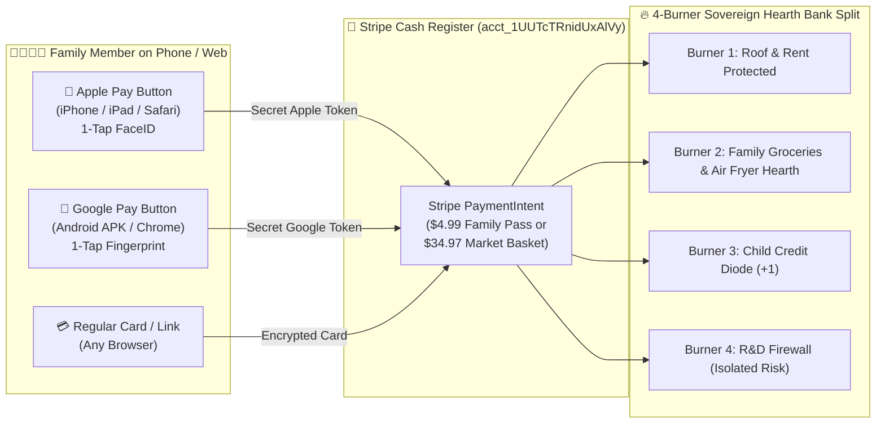

# 🧒 ELI5 ("Explain Like I'm 5"): How Stripe, Apple Pay (` Pay`) & Google Pay (`G Pay`) Work in `zenUltraCooker` v2.1.0

> **Written with Love for Mom (`*` Alex ~ Alexandra / Dra), Peter (`◯`), Chris (`△`), and Nate (`◇`)**
> *So anyone in the family can understand how payments work in 5 minutes — including flipping Stripe to Live Mode on Alex's iPad!* `<3`

---

## 1. The Lemonade Stand Story (What Are Stripe, Apple Pay & Google Pay?)

Imagine our **`zenUltraCooker` Family App** is a cozy neighborhood **Farmers Market & Family Kitchen Stand**:

1. **💳 Stripe (`acct_1UUTcTRnidUxAlVy`) is the Magic Cash Register**:
   - Stripe sits safely behind the counter. When a family buys the **`$4.99/mo zenUltraCooker Family Pass`** or a **`$34.97 Local Farmers Market Basket`**, Stripe checks that the money is real and puts it directly into our **`8b.is` Bank Account** (specifically into the **4-Burner Sovereign Hearth** so Rent & Groceries are always protected first!).
2. **🍎 Apple Pay (` Pay`) is the Magic FaceID Wallet on iPhone, iPad & Mac**:
   - Nobody likes typing a 16-digit plastic credit card number while cooking dinner!
   - When someone on an iPhone or iPad taps **` Pay`**, their phone looks at their face (`FaceID`) or thumbprint (`TouchID`), hands a secret one-time token to **Stripe** (our cash register), and **BOOM — paid in 1 second!**
3. **🤖 Google Pay (`G Pay`) is the Magic Fingerprint Wallet on Android & Chrome**:
   - When someone on an Android phone (running our **`zenUltraCooker-v2.1.0.apk`**) taps **`G Pay`**, Android unlocks their saved card with their fingerprint and hands the secret one-time token to **Stripe** — **paid in 1 second!**

> **The Golden Rule (ELI5)**:
> **Apple Pay and Google Pay are the wallets; Stripe is the cash register that catches the money from both of them!** You do **not** need three separate bank setups — **all money from Apple Pay, Google Pay, and regular cards flows into the exact same Stripe account (`acct_1UUTcTRnidUxAlVy`)!**



---

## 2. Step-by-Step: Flipping Stripe from "Play Money" (Test) to "Real Money" (Live) on Alex's iPad 📱

Right now, Stripe has two switches: **Test Mode** (pretend Monopoly money for testing) and **Live Mode** (real dollars). Here is the exact 4-step checklist when you sit down with **Alex's iPad**:

1. **Open Safari on Alex's iPad** and go to **[https://dashboard.stripe.com](https://dashboard.stripe.com)**.
2. **Sign in + 2FA Code**:
   - Enter the login email & password.
   - Open the **Google Authenticator** app (or iPad email/multi-device prompt) and type the 6-digit code.
3. **Flip the "Test Mode" Toggle OFF**:
   - In the top-right corner of the Stripe Dashboard, tap the **"Test mode"** switch so it turns **Live** (the orange "Test mode" banner disappears).
4. **Copy the Two Magic Keys** (under **Developers → API keys**):
   - **Publishable Key (`pk_live_...`)**: Safe to put inside our Website (`index.html`), Android APK, and iOS App. Think of this as our store's public street address.
   - **Secret Key (`sk_live_...`)**: Goes **only** into our private server (`sops-nix` / Cloudflare Worker secret — **never** pasted into public code!). Think of this as the key to the safe.

---

## 3. How to Turn On Apple Pay (` Pay`) — ELI5 (3 Simple Steps) 🍎

### A. For our Website (`8b-is.github.io/zenUltraCooker` & `vaked.dev`)
1. In the **Stripe Dashboard**, go to **Settings → Payment methods → Apple Pay**.
2. Click **"+ Add new domain"** and type `vaked.dev` (or our checkout domain).
3. Stripe gives you a tiny verification file called `apple-developer-merchantid-domain-association`. We drop that file into `/.well-known/apple-developer-merchantid-domain-association` on our website and click **Verify**. Done! Any iPhone, iPad, or Mac visiting our site now sees the **` Pay`** button automatically!

### B. For our Native iOS App (`mobile/ios/ZenUltraCookerApp`)
1. In the **Apple Developer Portal**, we register the Merchant ID: **`merchant.is.8b.zenultracooker`** (already pre-wired in [`mobile/ios/ZenUltraCookerApp/ZenUltraCooker.entitlements`](../mobile/ios/ZenUltraCookerApp/ZenUltraCooker.entitlements)!).
2. In **Stripe Dashboard → Settings → Payment methods → Apple Pay → iOS Certificates**, download Stripe's CSR file, upload it to Apple to get `apple_pay.cer`, and upload `apple_pay.cer` back to Stripe.
3. Our iOS SwiftUI app calls `PKPaymentAuthorizationController` (or Stripe's `PaymentSheet.ApplePayConfiguration(merchantId: "merchant.is.8b.zenultracooker", merchantCountryCode: "US")`) — one tap with FaceID and it's paid!

---

## 4. How to Turn On Google Pay (`G Pay`) — ELI5 (2 Simple Steps) 🤖

### A. For our Website (`index.html`)
1. In the **Stripe Dashboard**, go to **Settings → Payment methods → Google Pay** and make sure it says **Enabled**.
2. **That's literally it!** Stripe's `PaymentElement` / `ExpressCheckoutElement` automatically shows the **`G Pay`** button on Chrome and Android browsers with zero certificate uploads required!

### B. For our Native Android `.apk` (`releases/zenUltraCooker-v2.1.0.apk`)
1. Our Android app (`is.eightb.zenultracooker`) includes the Google Play Services Wallet metadata in [`AndroidManifest.xml`](../mobile/android/app/src/main/AndroidManifest.xml):
   ```xml
   <meta-data
       android:name="com.google.android.gms.wallet.api.enabled"
       android:value="true" />
   ```
2. When building for **Test Mode**, Google Pay uses `ENVIRONMENT_TEST` (lets you test with a fake card without charging a penny).
3. When we flip to **Live Mode**, we set `environment = "PRODUCTION"` and pass Stripe as the gateway:
   ```json
   {
     "type": "PAYMENT_GATEWAY",
     "parameters": {
       "gateway": "stripe",
       "stripe:version": "2024-06-20",
       "stripe:publishableKey": "pk_live_YOUR_KEY_HERE"
     }
   }
   ```

---

## 5. How the Code Works Under the Hood (Copy-Paste Reference)

Every payment in `zenUltraCooker` v2.1.0 is just **Two Tiny Steps**:

### Step A: Our Server Creates a `$4.99` (499 cents) "Payment Intent"
```javascript
// Runs on our Cloudflare Worker / Rust Backend (uses sk_live_...)
const paymentIntent = await stripe.paymentIntents.create({
  amount: 499, // $4.99 in cents (or 3497 for $34.97 Farmers Market Box)
  currency: "usd",
  automatic_payment_methods: { enabled: true }, // Turns on Apple Pay + Google Pay + Cards automatically!
  metadata: {
    app: "zenUltraCooker-v2.1.0",
    hearth_burner: "BURNER_2_FAMILY_HEARTH",
    pawshaw_trademark: "PawShaw Kitty & Doggy"
  }
});
// Send `paymentIntent.client_secret` to the Web App, Android APK, or iOS App!
```

### Step B: The Phone/Browser Shows the 1-Tap ` Pay` / `G Pay` Sheet
- **On Web (`index.html`)**: Stripe's `elements.create('expressCheckout')` renders **` Pay`** and **`G Pay`** natively.
- **On Android (`mobile/android`)**: `AndroidHearthBridge.launchGooglePaySheet(amountUsd, bundleName)` opens the native Android Google Pay / Stripe sheet.
- **On iOS (`mobile/ios`)**: `ApplePayHearthCoordinator.presentApplePay(amountUsd:bundleName:)` opens the native iOS FaceID Apple Pay sheet (`merchant.is.8b.zenultracooker`).

---

## 6. Quick Summary Checklist for the Family Fridge 🧲

| Question | Simple Answer |
|---|---|
| **Where does all the money go?** | Into our single **`8b.is` Stripe Account (`acct_1UUTcTRnidUxAlVy`)**, regardless of whether the customer tapped **Apple Pay (` Pay`)**, **Google Pay (`G Pay`)**, or typed a card! |
| **Does `zenUltraCooker` ever touch raw card numbers?** | **Never!** Apple, Google, and Stripe lock the card numbers inside hardware vaults and only hand us a safe receipt (`#ZEN-...`). |
| **What is the SemVer version of our apps?** | **`v2.1.0`** (`versionCode: 20100`) across Rust, Web, Android APK (`zenUltraCooker-v2.1.0.apk`), and iOS SwiftUI (`ZenUltraCookerApp`). |
| **How is the family grocery budget protected?** | By the **4-Burner Sovereign Hearth Firewall (`Cap(Hearth) ⊥ Risk(R&D)`)** — family roof and food funds never mix with R&D risk. |
